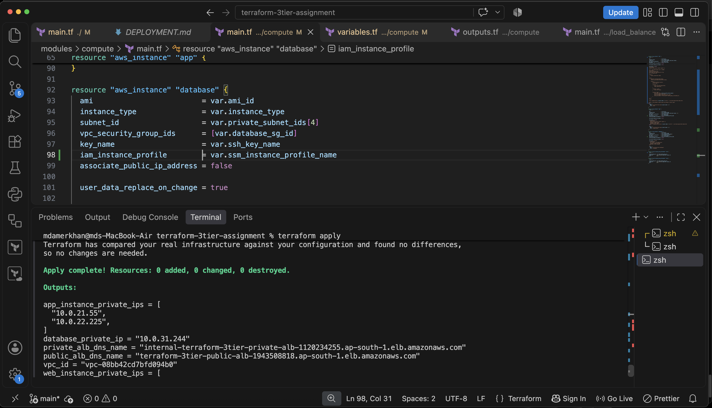
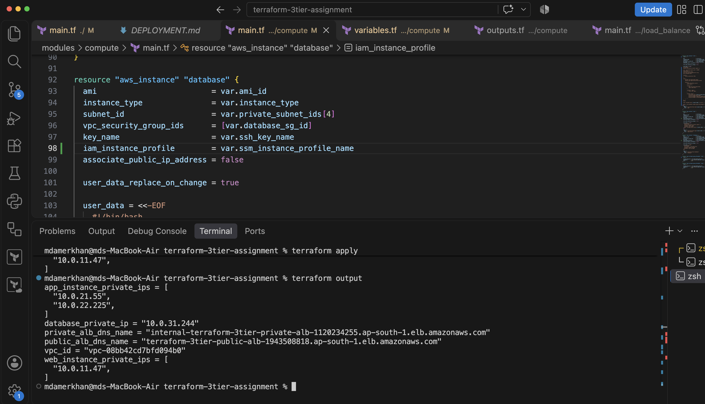
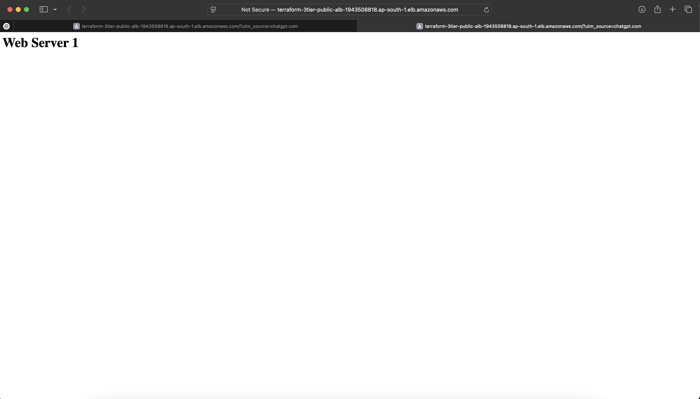
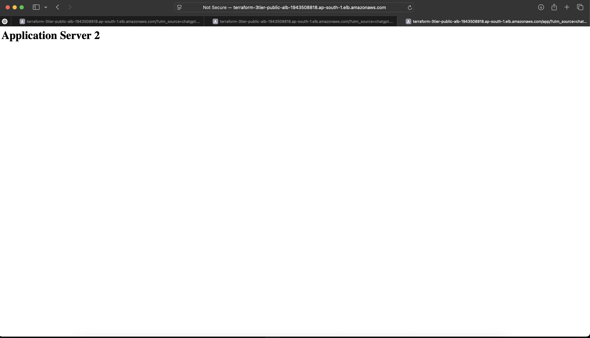
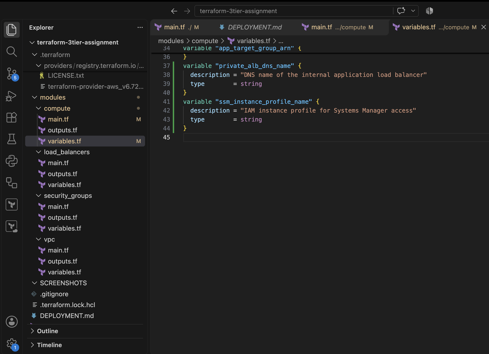

# AWS Three-Tier Infrastructure Automation with Terraform

<p align="center">
  <b>Infrastructure as Code | Amazon Web Services | Terraform</b>
</p>

<p align="center">
  A modular AWS three-tier architecture deployed using Terraform, featuring secure networking, load balancing, private compute instances and database isolation.
</p>

---

## Project Overview

This project demonstrates the design and deployment of a scalable, modular three-tier architecture on Amazon Web Services (AWS) using Terraform.

The infrastructure separates workloads into Web, Application and Database tiers, deployed within a custom Virtual Private Cloud (VPC) across multiple Availability Zones.

The objective is to demonstrate practical cloud infrastructure automation, network segmentation, load balancing and security best practices.

## Architecture

### Infrastructure Flow

```text
                  INTERNET
                      |
                      v
           PUBLIC APPLICATION LB
                      |
                      v
               WEB TIER
             Nginx Reverse Proxy
                      |
                      v
          INTERNAL APPLICATION LB
                      |
               +------+------+
               |             |
               v             v
          APP SERVER 1   APP SERVER 2
               |             |
               +------+------+
                      |
                      v
                DATABASE TIER
                 MariaDB EC2
```

### AWS Infrastructure

| Component | Configuration |
|---|---|
| Cloud Provider | AWS |
| IaC Tool | Terraform |
| Region | ap-south-1 |
| VPC | Custom VPC (10.0.0.0/16) |
| Availability Zones | 2 |
| Public Subnets | 2 |
| Private Subnets | 6 |
| Internet Gateway | 1 |
| NAT Gateways | 2 |
| Web Tier | 1 EC2 instance |
| Application Tier | 2 EC2 instances |
| Database Tier | 1 EC2 instance |
| Load Balancers | Public ALB + Internal ALB |
| Web Server | Nginx |
| Database | MariaDB |
| Access Control | AWS Security Groups |
| IAM | EC2 IAM Role and Instance Profile |

## Key Features

- Modular Terraform infrastructure.
- Multi-AZ VPC architecture.
- Public and private subnet separation.
- Public Application Load Balancer.
- Internal Application Load Balancer.
- Nginx reverse proxy configuration.
- Application traffic distribution across two EC2 instances.
- Private application and database instances.
- Database access restricted to the application security group.
- NAT Gateway-based outbound connectivity.
- IAM instance profile integration for Systems Manager.

## Technology Stack

- Amazon Web Services (AWS)
- Terraform
- AWS EC2
- AWS VPC
- Application Load Balancer
- Nginx
- MariaDB
- IAM
- AWS CLI
- Git and GitHub

## Repository Structure

```text
aws-three-tier-infrastructure-terraform/
│
├── main.tf
├── variables.tf
├── outputs.tf
├── iam.tf
├── terraform.tfvars.example
├── .gitignore
├── README.md
│
├── modules/
│   ├── vpc/
│   ├── compute/
│   ├── security-groups/
│   └── load-balancers/
│
└── SCREENSHOTS/
    ├── 01-terraform-apply.png
    ├── 02-terraform-outputs.png
    ├── 03-public-alb-nginx.png
    ├── 04-app-load-balancing.png
    └── 05-terraform-architecture.png
```

## Deployment Guide

### Prerequisites

- AWS account
- AWS CLI
- Terraform
- Configured AWS credentials
- Appropriate IAM permissions
- EC2 key pair

### 1. Clone the Repository

```bash
git clone https://github.com/Md-AmerKhan/aws-three-tier-infrastructure-terraform.git

cd aws-three-tier-infrastructure-terraform
```

### 2. Configure AWS CLI

```bash
aws configure
```

### 3. Configure Terraform Variables

```bash
cp terraform.tfvars.example terraform.tfvars
```

Update the variables with your own AWS configuration and EC2 key pair.

### 4. Initialize Terraform

```bash
terraform init
```

### 5. Format and Validate

```bash
terraform fmt -recursive
terraform validate
```

### 6. Review the Deployment Plan

```bash
terraform plan
```

### 7. Deploy Infrastructure

```bash
terraform apply
```

### 8. View Deployment Outputs

```bash
terraform output
```

## Testing and Verification

The following functionality was tested on the deployed infrastructure:

- Public ALB successfully returned HTTP 200.
- Nginx web page was accessible through the public ALB.
- Nginx reverse proxy successfully forwarded `/app/` requests.
- Internal ALB distributed requests across both application servers.
- Database EC2 instance was running and passed EC2 status checks.
- Database security group restricted port 3306 to the application tier.
- Terraform state contained the deployed infrastructure resources.

## Project Screenshots

### 1. Terraform Deployment



### 2. Terraform Outputs



### 3. Public ALB and Nginx



### 4. Application Load Balancing



### 5. Terraform Module Structure



## Security Considerations

- Application and database EC2 instances do not have public IP addresses.
- Database access is restricted through security-group references.
- SSH access is restricted to an administrative IP range.
- IAM instance profile integration is configured.
- Terraform state, private keys, credentials and local `.tfvars` files are excluded from Git.

**Note:** Systems Manager IAM integration is configured, but managed-instance registration has not yet been verified.

## Future Enhancements

- Complete AWS Systems Manager connectivity.
- Configure HTTPS using AWS Certificate Manager.
- Implement Auto Scaling.
- Add CloudWatch monitoring and alarms.
- Integrate GitHub Actions CI/CD.
- Add Terraform security scanning using Checkov.

## Cost Management

This architecture uses EC2, Application Load Balancers and NAT Gateways, which may incur ongoing AWS charges.

After confirming that the infrastructure is no longer needed, it can be removed using:

```bash
terraform destroy
```

Review the destruction plan carefully before confirming.

## Author

**Md Amer Khan**

B.Tech Cybersecurity Graduate | Cloud & DevOps Enthusiast

Areas of Interest:
- AWS Cloud
- Cloud Security
- DevOps
- Infrastructure as Code
- DevSecOps

---

⭐ If you find this project useful, consider starring the repository!

**GitHub:** [Md-AmerKhan](https://github.com/Md-AmerKhan)